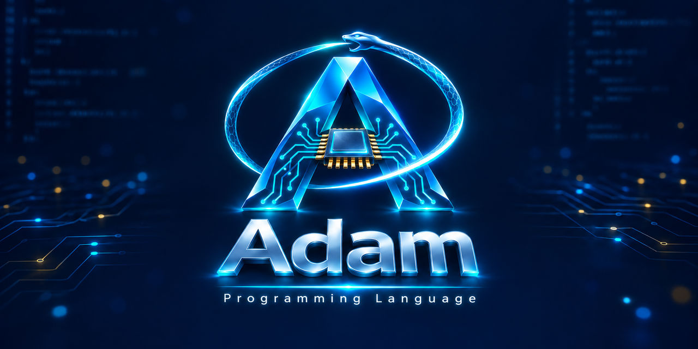

<p align="center">
  
</p>

<p align="center">
  <a href="https://discord.gg/Wb6z8Wam7p"></a>
  <a href="https://bsky.app/profile/tinybiggames.com"></a>
</p>

<p align="center">
  <strong>Write Pascal-style code, get native machine code from a compiler written in itself.</strong>
</p>

<p align="center">
  <a href="https://adamlang.org">Homepage</a> ·
  <a href="https://github.com/tinyBigGAMES/AdamLang/releases">Releases</a>
</p>

> [!WARNING]
> **Adam is a work in progress.** We are actively working on the language, the compiler and the standard library, leading toward a first release. Until then things change from one commit to the next, and the documentation is still to come.

# Adam

Adam is a Pascal and Oberon inspired, general purpose systems programming language. Its compiler is written in Adam and compiles itself, and it turns `.adam` source straight into native x86_64 machine code with its own code generator and linker: no C compiler, no assembler and no external linker in the way.

## 🔥 What it is

Adam's syntax follows Pascal and Oberon: blocks open and close with words, assignment is `:=` and equality is `=`, every control-flow construct carries its own `end`, every statement ends with `;`, and names are declared before they are used.

The compiler reads each module through its own lexer, parser and semantic checker into one syntax tree, lowers it to an SSA form, optimizes it, selects x86_64 instructions, allocates registers, encodes the machine code and writes COFF objects, which its own linker turns into a Windows x64 executable. One source builds an executable (`module exe`). Win64 (x86_64-windows-gnu) is the first target; x86_64-linux-gnu comes next, and every part of the compiler is written with more targets in mind.

C is reached by declaration, never by include: a routine declared `external` (with C or C++ linkage) is called like any Adam routine, and vendored C static libraries link through Adam's own linker.

## 🚀 A first look

`readme_first_look.adam`: a task that computes a square on a thread of its own while a `for parallel` loop adds 1 to 100 across the machine's cores, then the task's result read with `await`.

```adam
module exe readme_first_look;

// The square of AValue, run as a task
routine Square(const AValue: int64): int64;
begin
  return AValue * AValue;
end;

var
  LTask: task int64;
  LSum: int64;

begin
  LTask := async Square(12);
  LSum := 0;
  for parallel I := 1 to 100 do
    atomicadd(LSum, I);
  end;
  println("square {}", await LTask);
  println("sum {}", LSum);
end.
```

Build it:

```text
adam build readme_first_look.adam
```

The executable lands in `output\bin\x86_64-windows-gnu\debug\`. Its output:

```text
square 144
sum 5050
[Heap] Allocs: 16, Frees: 16, Leaked: 0
```

A build is `debug` by default, and a debug build prints the runtime's heap report (the `[Heap]` line) when the program ends.

## ✨ Highlights

- **Self-hosted.** The compiler, its runtime and its standard library are written in Adam. Every compiler build is proven by a fixpoint: the compiler built by itself, twice, must come out byte for byte the same.
- **Its own back end.** SSA lowering, an optimizer, instruction selection, register allocation, an x86_64 encoder, a COFF object writer and a linker, all in the box. The output is deterministic at every optimize level.
- **Readable by design.** Pascal and Oberon blocks, `:=` for assignment, `;` after every statement, each construct closed by its own `end`; enums are `choices`, written `Name.Value`.
- **Memory you can reason about.** Strings, dynamic arrays and objects are managed: `own`, `ref` and `weak` owners with reference counts that are safe across threads, and a debug build reports every leak with where it was allocated.
- **Objects and interfaces.** Object types with inheritance, virtual methods, `init` / `copy` / `done`, properties, interfaces, `is` / `as`, and operator declarations.
- **Threads in the language.** `async` / `await` tasks (of a call, or of a whole `begin .. end` block), `cancel` / `cancelled`, `for parallel`, `lock` / `trylock`, atomics and `threadstatic` variables.
- **Exceptions that unwind.** `raise`, `guard` with `except` / `finally`, on the platform's native unwinding, so every cleanup the language promises runs.
- **Data layout like C.** Records (packed or aligned), overlays (unions), bitfields, anonymous members and inline record / overlay fields, laid out as C lays them out, so a C header maps one to one.
- **Errors speak Adam.** Every diagnostic is reported at the `.adam` file, line and column, in Adam's own words, even when the linker finds the problem.
- **Fast rebuilds.** Units compile once into `.acu` compiled units; the runtime and the standard library ship precompiled, and only what changed is compiled again.

## 🛠️ Tools

- **`adam`**, the compiler: `adam build <file>`, `adam check <file>` (the front end only), and `adam init` / `adam pack` for a project folder with assets; `adam help` lists every command and option.
- **`adamtest`**, the test runner: Adam's own test suite runs with `adamtest -all`, from an unzipped release, with nothing else installed.

## 📦 Getting Adam

Releases will be published on [GitHub Releases](https://github.com/tinyBigGAMES/AdamLang/releases) once the compiler is ready for them. Until then, Adam is a project to follow, not one to install.

## 🔧 Building from source

For contributors who want to change the compiler itself.

| | Requirement |
|---|---|
| **Host OS** | Windows x64 |
| **A compiler** | An existing `adam.exe` in `bin\`: Adam is self-hosted, so it takes an Adam compiler to build one |

1. **[Download ZIP](https://github.com/tinyBigGAMES/AdamLang/archive/refs/heads/main.zip)** or clone the repo:

   ```text
   git clone https://github.com/tinyBigGAMES/AdamLang.git
   ```

2. Run `bin\build-adam.cmd`. It builds the compiler three times (the installed `adam.exe` builds stage A, A builds B, B builds C), checks that B and C are identical, builds `adamtest` with B, and installs both in `bin\`. It ends with `BUILD OK` or `BUILD FAILED`.

## 🤝 Contributing

- **Report bugs** with a minimal `.adam` reproduction, the exact command used, and the compiler's diagnostics.
- **Suggest features**: describe the use case first, then the behavior you have in mind.
- **Submit pull requests** for bug fixes, new test cases and well-scoped features; open an issue first for substantial language or compiler changes.

Read [CONTRIBUTING](https://github.com/tinyBigGAMES/AdamLang?tab=contributing-ov-file) and the [Code of Conduct](https://github.com/tinyBigGAMES/AdamLang?tab=coc-ov-file) before you start. Join the [Discord](https://discord.gg/Wb6z8Wam7p) to talk development, ask questions, or show what you are building.

## 💖 Support the project

If Adam interests you or sparks something useful:

- ⭐ **Star the repo**: it costs nothing and helps others find the project
- 📣 **Spread the word**: write a post, mention it in a community, or share a screenshot
- 💬 **Join the community**: help shape what comes next on [Discord](https://discord.gg/Wb6z8Wam7p)
- 💖 [**Become a sponsor**](https://github.com/sponsors/tinyBigGAMES): sponsorship directly funds development, examples, and documentation

## 📜 License

Adam is free and open source under the **Mozilla Public License 2.0**: see [LICENSE](https://github.com/tinyBigGAMES/AdamLang?tab=MPL-2.0-1-ov-file) and [NOTICE](NOTICE.md). The runtime and standard library files that Adam builds into your programs carry an additional permission: see [RUNTIME-EXCEPTION](RUNTIME-EXCEPTION.md). The Adam name and marks: [TRADEMARK](TRADEMARK.md).

## 🔗 Links

- 🌐 [Homepage](https://adamlang.org)
- 🐞 [Issues](https://github.com/tinyBigGAMES/AdamLang/issues)
- 💬 [Discord](https://discord.gg/Wb6z8Wam7p)
- 🦋 [Bluesky](https://bsky.app/profile/tinybiggames.com)
- 🎮 [tinyBigGAMES](https://tinybiggames.com)

<div align="center">

**Adam**&#8482; Programming Language

Copyright &copy; 2026-present tinyBigGAMES&#8482; LLC  
All Rights Reserved.

</div>
